# Spieltest-Bericht – Pizza-Belag-Simulator

**Datum:** 16.11.2026 · **Ort:** Roblox Studio auf dem PC, Place „Pizza-Belag-Simulator“ (privat) · **Stand:** `main` nach #16, 230 Tests grün

**Wie getestet:** Einzelspieler-Play in Studio, gesteuert per Bildschirmsteuerung. Weil sich die Kamera ohne Rechtsklick-Ziehen nicht drehen lässt, habe ich die Figur oft per Studio-Befehlsleiste zu den Stationen gesetzt und Kamerabilder per Skript gemacht. Für Tränke, Telefon und späte Welten habe ich vorübergehend Testwerte gesetzt (nicht committet). Der Spielstand wurde kurz zurückgesetzt und danach aus einem Backup wiederhergestellt.

**Nicht getestet:** Mehrspieler (2 Fenster), Handy/Device-Emulator, Sounds/Musik (noch keine IDs), Rejoin-Fälle bei Tränken/Aufträgen.

## Was funktioniert

| Bereich | Ergebnis |
| --- | --- |
| Sammeln & Verkaufen | Anklicken, Reichweite („Zu weit weg!“), volle Pizza, Auto-Sammeln, Magnet, Verkauf mit Münzflug-Animation |
| Tutorial | 4 Schritte mit Pfeil und gelber Linie, danach weg; bleibt nach Neustart weg; Zwischenstand wird gespeichert |
| Shop 1–3 | Münz- und Gem-Tresen, Stufen bis Shop-Maximum, „Im größeren Shop erhältlich“, lange Preise (1.200.000.000) passen |
| Eier & Pets | Vorschau mit 3D-Pets, Knack-Animation, 3D-Pet-Karte, Sperre gegen Mehrfachklick, 3 Eier auf einmal, Pet-Bonus beim Verkauf |
| Pet-Verwaltung | Beste ausrüsten, Ablegen, Löschen mit Nachfrage (auch ausgerüstete), Platz-Grenze |
| Gems | Zwei Anzeigen, Gem-Diamanten im Feld, Spielzeit-Gems, Gem-Upgrades (Pet-Plätze, Inventar, Tempo) |
| Tränke | Kauf im Shop, Trank-Menü, drei Anzeigen mit Timer, Glück verändert die Ei-Chancen sichtbar |
| Lieferdienst | Telefon klingelt nach dem Tutorial, Auftrags-Panel, Auftragskarte mit Timer, falsche Beläge werden erkannt, Ofen verkauft nur Überzählige, Lieferung zahlt aus |
| Barrieren & Portale | Freischalten aller 6 Barrieren mit richtigen Preisen, Server setzt zurück, wer in eine gesperrte Welt gerät, Portal-Menü und Teleport |
| Welten 1–7 | Alle mit eigenem Licht, Boden, Deko und 60 Belägen; Kuppelöfen überall |
| Speichern | Münzen, Pizza, Tutorial, Auto-Sammeln, Upgrades bleiben nach Stop/Play |
| Server-Schutz | Gesperrter Teleport, 5 Eier auf einmal, Kauf außerhalb des Shops, Freischalten aus der Ferne: alles abgelehnt |
| Fehler im Output | Keine (nur eine Warnung der Studio-Vorlage, Asset 203785492, nicht aus unserem Code) |

## Gefundene und behobene Fehler

| Fehler | Fix |
| --- | --- |
| Ofen-Modell: glühende Öffnung zeigte von der Verkaufszone weg | `YAW.PizzaOven = 180` in `src/shared/ModelLibrary.luau` |

## Offene Probleme

| Schwere | Problem | Wo |
| --- | --- | --- |
| Mittel | Kamera wird an Ofen, Shop, Ei und Telefon nah an den Kopf gedrückt, weil die Stationen hinter der Startkamera (+Z) stehen | alle Welten |
| Mittel | UI-Überlappungen: Tutorial-Karte überdeckt Meldungen und Ei-Vorschau; Shop-Menü überdeckt Münz-/Gem-Anzeige; Freischalt-Knopf liegt auf dem Auto-Sammeln-Knopf; im Teleport-Menü ist der unterste Eintrag halb unter der Pizza-Leiste | HUD |
| Mittel | Pet-Namensschild schwebt über dem „1 öffnen“-Knopf der Ei-Vorschau | `11-glueck-ei.jpg` |
| Klein | Schilder ferner Welten (z. B. „Riesiger Pizza-Shop“ aus Welt 7) sind von Welt 1 aus zu sehen | Billboards ohne `MaxDistance` |
| Klein | Shop-Menü öffnet an der Scroll-Stelle des zuletzt besuchten Shops, nicht oben | Shop-Menü |
| Klein | Untertitel im Trank-Menü abgeschnitten („…verlängert die“) | Trank-Menü |
| Klein | Shop-Karten zeigen „Stufe x von 6“ (Shop-Maximum), die Checkliste erwartet „von 8“ – Text vereinheitlichen | Shop 2 |
| Klein | Pets stellen sich am Ofen aufs Dach bzw. stecken halb in der Wand | PetService |
| Klein | Salami-Modell (rot mit weißen Punkten) wirkt wie ein Fliegenpilz | `Salami.fbx` |
| Info | „Lighting.Technology = Future“ lässt sich in dieser Studio-Version nicht mehr setzen | #15 |
| Info | Sounds und Musik sind noch stumm (IDs fehlen) | `Sounds.luau` |

## Eindruck

**Optik:** Der Low-Poly-Look ist stimmig und freundlich. Kuppelofen, Pizza in der Hand, Teig-Hamster mit Kochmütze und die Deko der Welten wirken wie aus einem Guss. Jede Welt erkennt man sofort an Farbe und Deko. Der Vulkan ist recht dunkel, der Weltraum mit den leuchtenden Belägen sieht sehr gut aus.

**Spielgefühl:** Die Schleife Sammeln → Ofen → Shop → Ei ist sofort verständlich, das Tutorial führt gut hinein. Tränke und Lieferaufträge bringen Abwechslung. Größter Störfaktor ist die Kamera an den Stationen, die man ständig sieht.

**Balancing (ohne Testwerte):** Eine Runde mit 2 Belägen bringt im Schnitt etwa 3–4 Münzen. Bis zum ersten Upgrade (25) braucht man 7–10 Runden, bis zum ersten Ei noch einmal so viele. Das ist für die ersten Minuten eher zäh. Der erste Lieferauftrag zahlte 8 Münzen – ein guter Anreiz. Spätere Stufen (Barrieren 1.500 → 150 Mio, Shop 3 bis 1,2 Mrd) konnten ohne lange Spielzeit nicht realistisch bewertet werden.

## Verbesserungsvorschläge

1. Stationen (Ofen, Shop, Ei, Telefon) vor den Spawn stellen oder die Startkamera Richtung Stationen drehen; alternativ die Stationen für die Kamera durchlässig machen.
2. Ein festes HUD-Raster: Meldungen unter der Münzanzeige, Tutorial-Karte links, Menüs unter dem HUD statt darüber.
3. Erstes Upgrade auf ca. 15 Münzen senken oder den Startwert der Beläge leicht erhöhen, damit der erste Kauf nach 3–4 Runden kommt.
4. Billboards mit `MaxDistance` versehen (ca. 150 Studs).
5. Salami-Modell flacher und mit dunkleren, kleineren Fettaugen.
6. Sounds und Musik eintragen – das macht beim Sammeln und Verkaufen viel aus.

## Screenshots

| | |
| --- | --- |
| 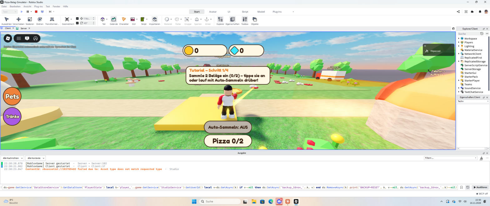 Start mit Tutorial | 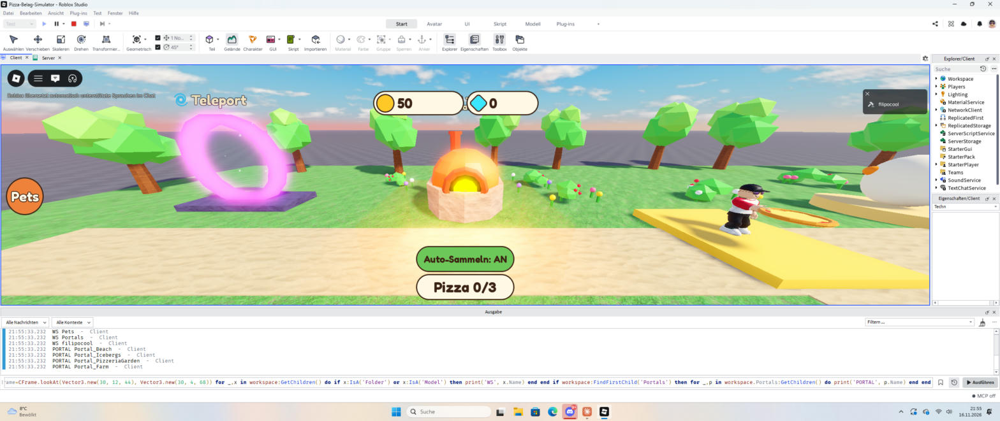 Welt 1: Ofen, Portal |
| 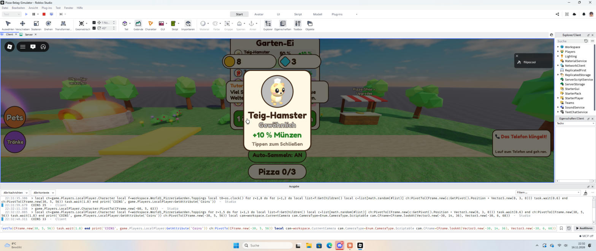 Ei geöffnet | 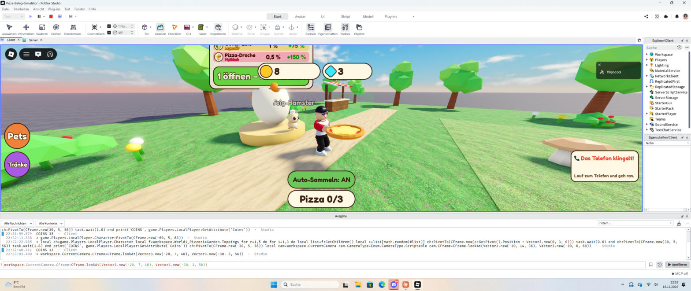 Pet folgt |
| 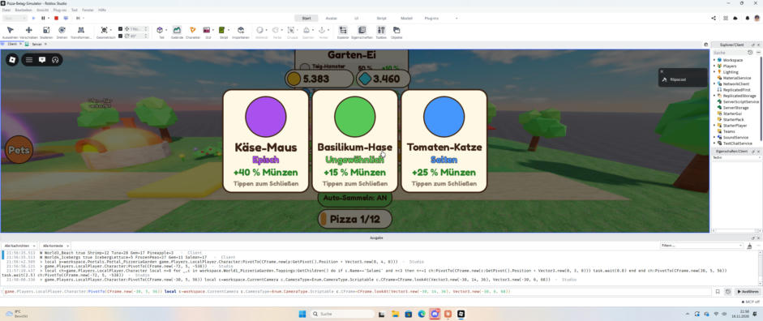 3 Eier auf einmal | 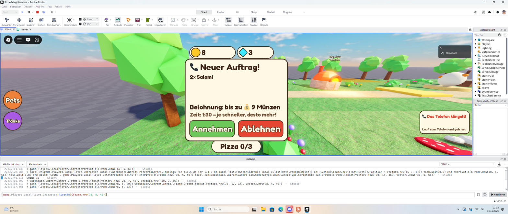 Telefon-Auftrag |
| 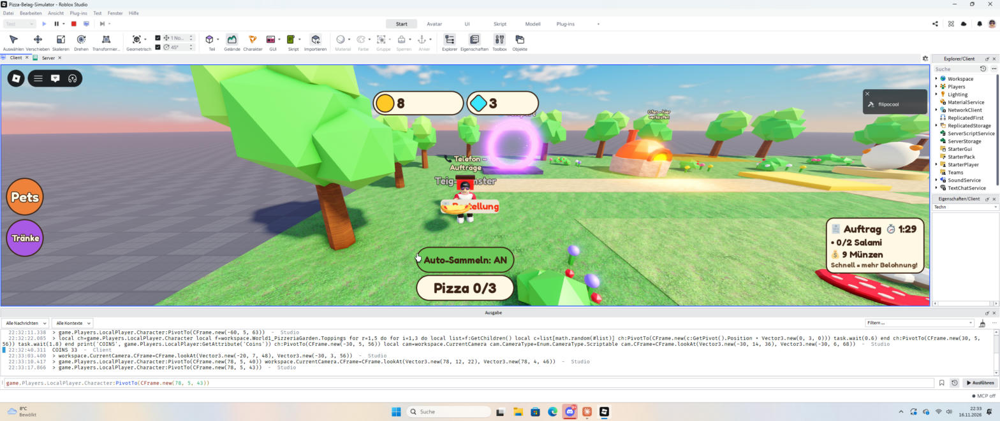 Auftragskarte | 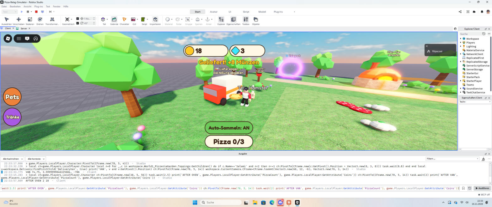 Geliefert |
| 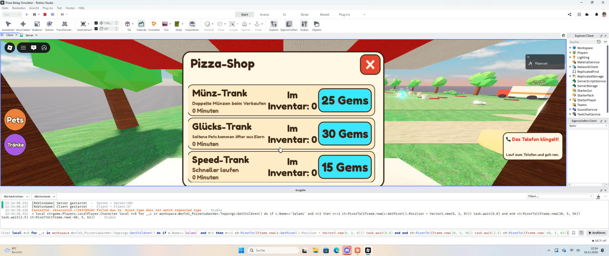 Tränke im Shop | 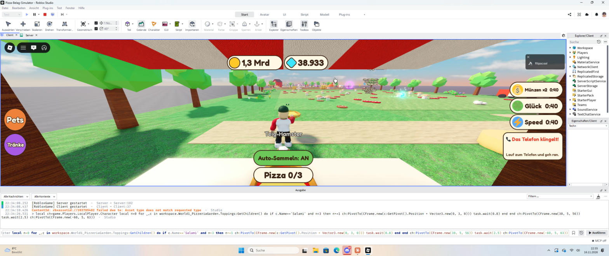 Trank-Anzeigen |
| 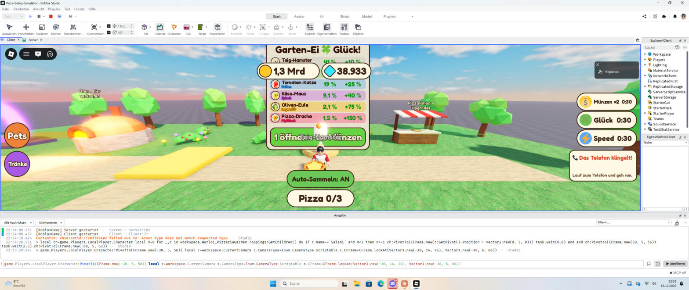 Glücks-Trank am Ei | 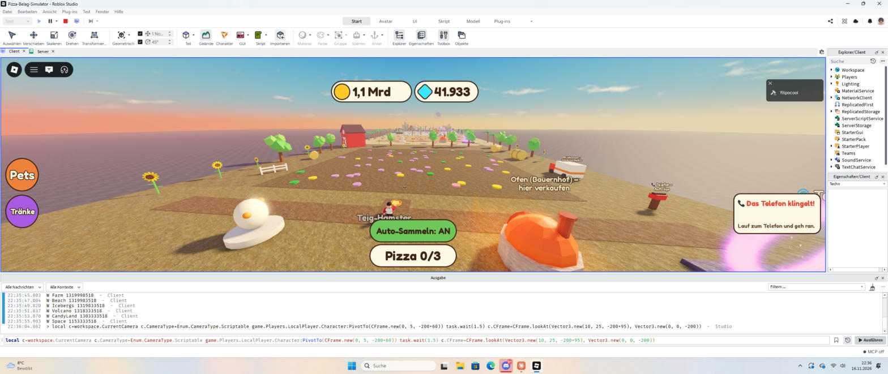 Welt 2 Bauernhof |
| 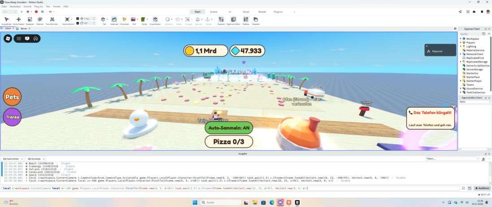 Welt 3 Strand | 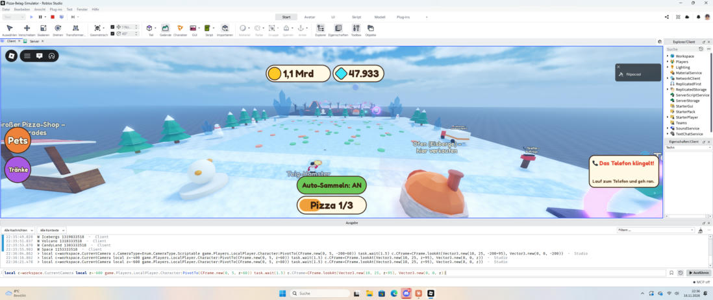 Welt 4 Eisberge |
| 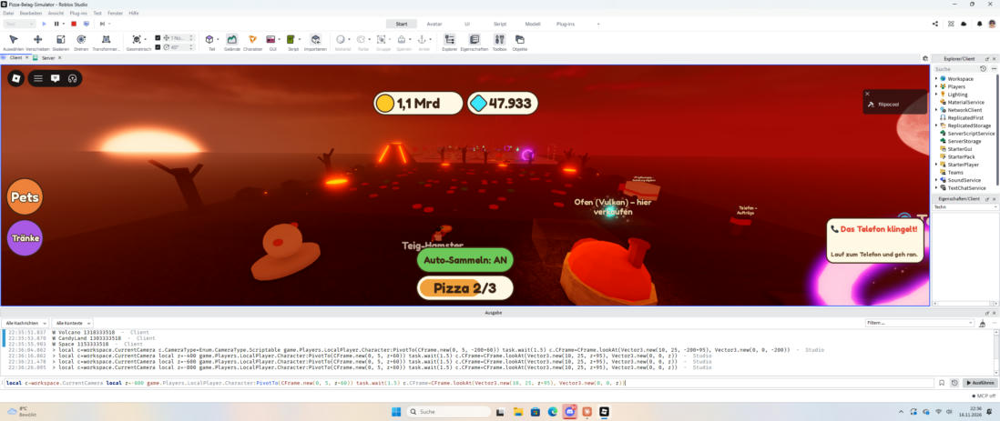 Welt 5 Vulkan | 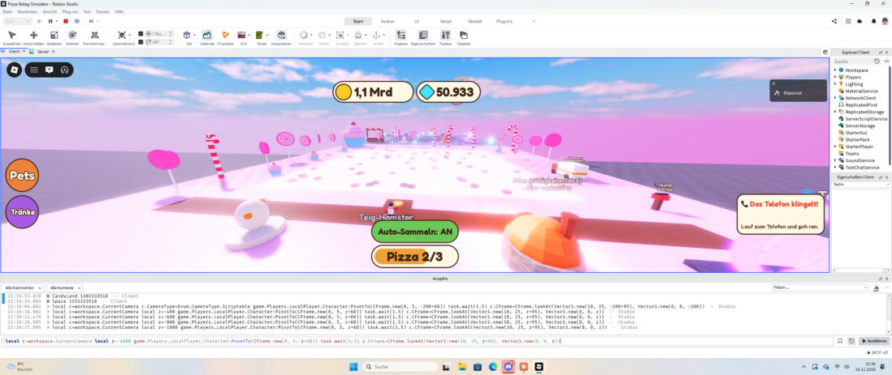 Welt 6 Süßigkeitenland |
| 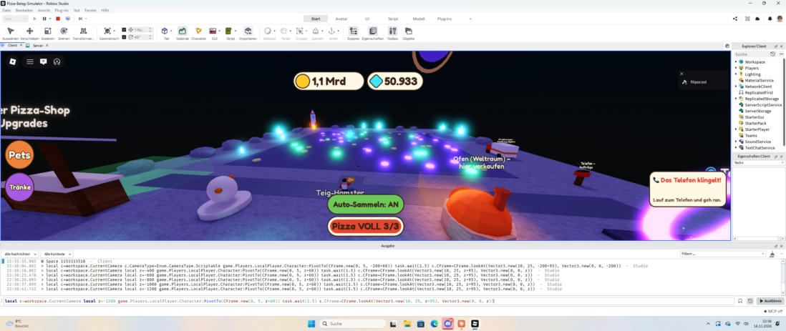 Welt 7 Weltraum | 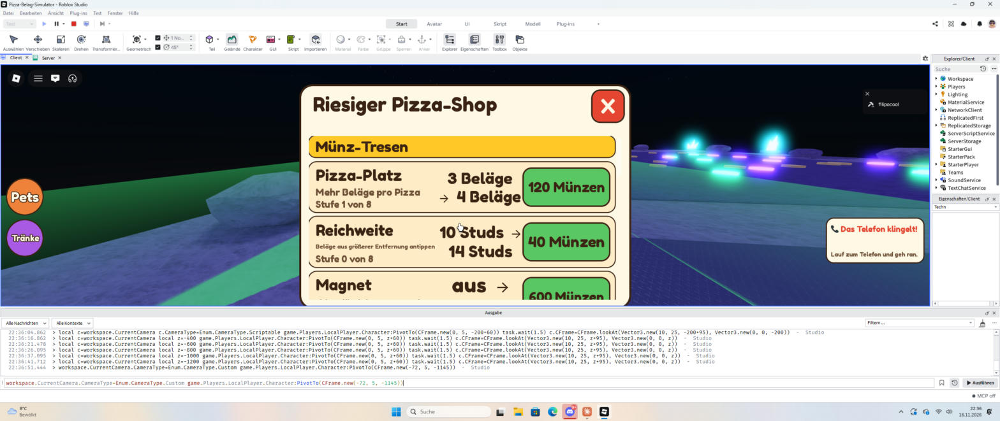 Riesiger Pizza-Shop |
